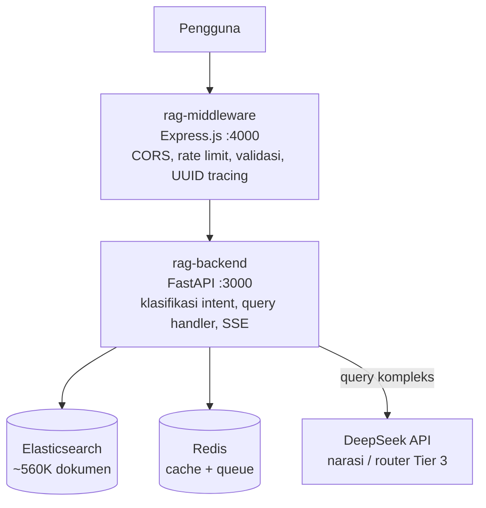
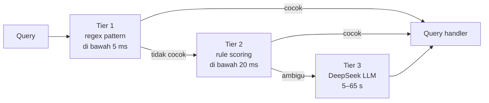

# RAG Kemendikdasmen — Sistem Pencarian Data Pendidikan


Sistem Retrieval-Augmented Generation (RAG) untuk pencarian dan narasi data ~560.000 sekolah seluruh Indonesia. Dibangun untuk Kementerian Pendidikan Dasar dan Menengah (Kemendikdasmen).

## Deskripsi

Sistem ini memungkinkan pejabat Kemendikdasmen, dinas pendidikan daerah, dan masyarakat umum untuk mengajukan pertanyaan dalam bahasa natural dan mendapatkan jawaban yang akurat tentang data sekolah — mulai dari daftar sekolah per wilayah, jumlah sekolah per jenjang, profil sekolah spesifik, hingga perbandingan antar wilayah.

**Contoh pertanyaan yang bisa dijawab:**
- "Berapa jumlah SD negeri di Kabupaten Bandung?"
- "Tampilkan daftar SMA akreditasi A di Surabaya"
- "Profil SMAN 3 Bandung"
- "Bandingkan jumlah SMK di Jakarta dan Surabaya"
- "Sekolah terdekat dari lokasi saya"

## Fitur utama

- **Pencarian bahasa natural** untuk daftar sekolah, agregasi, profil sekolah, dan perbandingan antar wilayah.
- **Klasifikasi query berlapis (Tier 1–3)** yang menekan pemakaian LLM: 74% query selesai tanpa LLM.
- **Streaming jawaban** lewat Server-Sent Events (SSE).
- **Cache berlapis** dan antrean tugas latar belakang dengan Redis.
- **Rate limiting dua lapis** di middleware (per IP) dan backend (per user).
- **Siap deploy ke Kubernetes**, dengan worker arq sebagai sidecar.

## Arsitektur



### Klasifikasi berlapis — 74% query tanpa LLM



- Tier 1: regex pattern, <5ms
- Tier 2: rule scoring, <20ms
- Tier 3: DeepSeek LLM, 5–65s (hanya untuk query kompleks)

## Struktur Repository

```
prompting/
├── rag-backend/        # FastAPI — business logic, klasifikasi, handler
├── rag-middleware/     # Express.js — proxy, rate limit, validasi
├── k8s/                # Kubernetes manifests (ConfigMap, Secret, Deployment)
└── README.md
```

## Status

| Komponen | Status |
|----------|--------|
| Phase 1–15 | ✅ Selesai |
| Phase 16 (tech debt) | ✅ Selesai |
| Total tests | 642 passed |
| Data sekolah | ~560K (38 provinsi, 600+ kab/kota) |
| LLM calls ditekan | 74% query no-LLM |

## Konfigurasi Environment

File `.env` tidak disimpan di repo. Salin dari template lalu isi nilainya:

```bash
cp rag-backend/.env.example rag-backend/.env
cp rag-middleware/.env.example rag-middleware/.env
```

## Quick Start

Lihat README masing-masing komponen untuk instruksi lengkap:

- [`rag-backend/README.md`](rag-backend/README.md) — setup Python, environment, menjalankan server
- [`rag-middleware/README.md`](rag-middleware/README.md) — setup Node.js, konfigurasi proxy

## Deployment

Manifest Kubernetes tersedia di folder `k8s/`:

```bash
# Apply ConfigMap dan Deployment
kubectl apply -f k8s/configmap-backend.yaml
kubectl apply -f k8s/configmap-middleware.yaml
kubectl apply -f k8s/deployment-backend.yaml

# Secret — isi nilai asli terlebih dahulu, JANGAN commit setelah diisi
# cp k8s/secret-backend.yaml k8s/secret-backend.local.yaml
# kubectl apply -f k8s/secret-backend.local.yaml
```

Deployment backend menggunakan dua container dalam satu pod:
- **FastAPI server** — melayani request HTTP
- **arq worker** (sidecar) — menjalankan background jobs dengan guarantee delivery via Redis

## Tech Stack

| Komponen | Teknologi |
|----------|-----------|
| Backend | Python 3.11, FastAPI 0.128.0 |
| Middleware | Node.js ≥20 LTS, Express.js 5 |
| Database | Elasticsearch 8.x |
| Cache & Queue | Redis 7.x, arq 0.28.0 |
| Embedding | sentence-transformers all-MiniLM-L6-v2 |
| LLM | DeepSeek API (deepseek-chat) |
| Orchestration | Kubernetes |

## Lisensi

Dirilis di bawah lisensi MIT. Lihat berkas [LICENSE](LICENSE).
